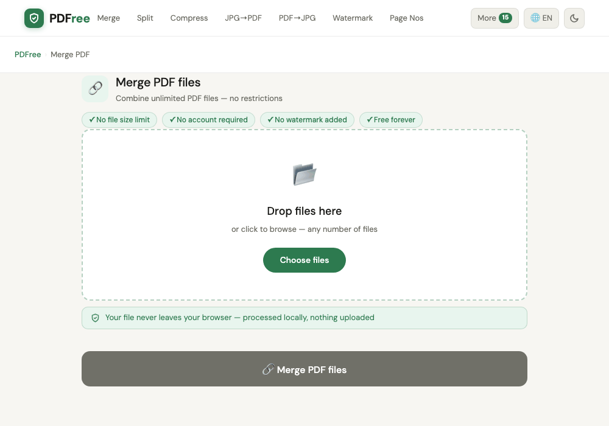

# PDFree

**Free, open-source PDF tools with privacy-first, in-browser processing.**

[Use PDFree](https://pdfree.io/) · [Report a bug](https://github.com/mahmudovbahrom555-lab/pdfree33/issues/new/choose) · [Contribute](CONTRIBUTING.md) · [Self-host](SELF_HOSTING.md)

[](LICENSE)
[](https://pdfree.io)
[](https://github.com/mahmudovbahrom555-lab/pdfree33/actions/workflows/deploy.yml)

PDFree helps you work with PDFs without creating an account. Its main web tools are designed to process document content on your device instead of sending PDFs to a conversion server. The project is licensed under AGPLv3, so you can inspect the source.



## Try it

- [Merge PDF](https://pdfree.io/merge-pdf/) — combine documents.
- [Split PDF](https://pdfree.io/split-pdf/) — extract or separate pages.
- [Compress PDF](https://pdfree.io/compress-pdf/) — reduce file size where possible.
- [OCR PDF](https://pdfree.io/ocr-pdf/) — recognize text in scanned documents.

Other tools include rotation, organization, annotations, redaction, forms, signatures, and PDF conversions. See the [website](https://pdfree.io/) for the current list.

## Privacy and practical limits

- **Document contents:** The browser-based PDF tools are built for local document processing. Your PDF does not need to be uploaded to a PDF-conversion service to use these tools.
- **Other network traffic:** The website still requests pages and assets, may load libraries from CDNs on first use, sends coarse tool-usage events to `/api/analytics`, and transmits feedback (including any attachment) if you explicitly submit it. “Local PDF processing” does not mean “zero network requests.”
- **File size and performance:** There are tool-specific size limits (see [`js/fileLimits.js`](js/fileLimits.js)). Processing large documents also depends on available browser memory and device capabilities.
- **Offline use:** The site is installable as a PWA and caches resources. Some tools require an internet connection the first time their dependencies are loaded; offline availability depends on what is already cached.

You can inspect the browser's Network panel and the relevant source modules to evaluate these claims.

## Run locally

Requires Node.js (CI uses Node 20), Python 3, and the Python package `jinja2`:

```bash
git clone https://github.com/mahmudovbahrom555-lab/pdfree33.git
cd pdfree33
npm ci
python3 -m pip install jinja2
python3 scripts/build.py
python3 -m http.server 8080 --directory dist
```

Open [http://localhost:8080](http://localhost:8080). Some features may still fetch third-party libraries on first use.

## Test and contribute

```bash
npm test               # logic and integration tests
npm run validate       # DOM/i18n/vendor checks, lint, tests, build
npm run check:claims   # checks selected website claims separately
```

See [CONTRIBUTING.md](CONTRIBUTING.md) for setup, architecture, browser E2E tests, and contribution guidelines. Please report suspected security vulnerabilities **privately** as described in [SECURITY.md](SECURITY.md), not in a public bug report.

## Technology and license

Vanilla JavaScript, Web Workers, pdf-lib/pdf.js, optional WebAssembly dependencies, a Python/Jinja2 static-site build, and Cloudflare Workers for hosting and selected site endpoints. Self-hosting instructions are in [SELF_HOSTING.md](SELF_HOSTING.md).

[GNU Affero General Public License v3.0](LICENSE). Third-party dependencies retain their respective licenses.
